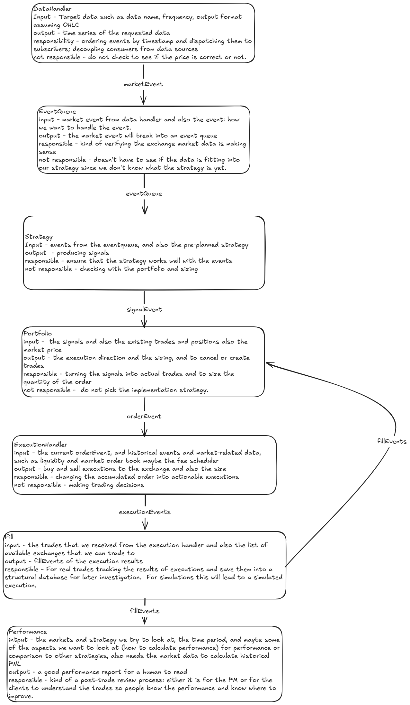

# quant-lab

Trading-system components built from scratch — an event-driven backtest engine, an L2 order book reconstruction, and execution/low-latency pieces.

The goal is not another `signal.shift(1) * returns` notebook. It is the parts a quant developer actually gets asked about in an interview: **how does an order become a fill, what did you assume about slippage, and how do you know there is no look-ahead bias.**

> **Status: early.** Design is done (see below); the engine implementation starts in November 2026. Nothing here is a working backtester yet.

---

## Why this repo exists

Vectorised backtests are three lines long and cannot answer basic questions:

- At what price did the order actually fill — close, next open, or the bar's high/low?
- What happened when the bar had no volume, or the stock was suspended?
- Where does the fill price come from, and who applies fees and slippage?

This repo builds the slow, explicit version of that loop, so those questions have answers.

## P1 · Event-driven backtest engine



Seven components, each with a narrow contract. The `not responsible` column is the one that matters — it is what keeps modules from bleeding into each other.

| Component | Responsible for | Explicitly **not** responsible for |
|---|---|---|
| `DataHandler` | Loading, timezone alignment, duplicate/missing-timestamp detection, retry on connection failure | Judging whether a *price* is correct |
| `EventQueue` | Ordering events by timestamp, dispatching to consumers, decoupling consumers from data sources | Data-quality validation, cleaning, gap filling |
| `Strategy` | Turning market events into signals, given its parameters | Position sizing, portfolio state, execution |
| `Portfolio` | Signals + current positions + mark prices → target position → `OrderEvent` | Generating signals, choosing how to execute, computing performance |
| `ExecutionHandler` | Converting orders into actionable executions (live: routing; backtest: handing to the fill simulator) | Making trading decisions |
| `Fill` | **Backtest:** deciding fill price, filled quantity, slippage, fees. **Live:** recording exchange fills | Trading decisions |
| `Performance` | Post-trade reporting: returns, drawdown, turnover, attribution | Producing trades |

### Three decisions worth defending

1. **`Fill → Portfolio` is a return edge, not a one-way pipe.** Without it, positions and cash never update and PnL stays zero. Execution is a loop, not a pipeline.
2. **`Portfolio` emits `OrderEvent` (an order), not `orderBook` (market data).** The order book comes from `DataHandler`; the portfolio only decides *what it wants*, never *what the market looks like*.
3. **`Fill` is where the price is decided.** In a backtest it *is* the exchange — it owns the fill price, quantity, slippage and fee assumptions. `Performance` only reads results; it never invents costs.

## Roadmap

| Milestone | What | Status |
|---|---|---|
| **P1** | Event-driven backtest engine (this repo's first real code) | design ✅ / code ⬜ |
| **P2** | L2 order book reconstruction + replay (Binance / OKX depth diff) | ⬜ |
| **P5** | Low-latency components in C++ (ring buffer, matching hot path) | ⬜ |

P1 uses **equities** deliberately: suspensions, adjustment factors and market hours force the boring correctness checks. P2 is **crypto** because free full-depth data with 24/7 ticks is what makes microstructure work possible.

## Getting started

```bash
uv sync
uv run pytest
```

Python 3.12, managed by [uv](https://docs.astral.sh/uv/).

## Data

Daily OHLCV pulled with `yfinance` (HK equities + HSI), adjusted for splits and dividends (`auto_adjust=True`).

Raw data is **not** committed — see `.gitignore`. `scripts/` regenerates it. Nothing in the repo depends on a specific snapshot being present.

## P1 acceptance criteria

- [ ] Same strategy, same data: engine output matches a hand-computed, trade-by-trade result within `1e-6`
- [ ] 100k bars × 10 symbols backtest in under 10 seconds (local machine)
- [ ] Core modules above 70% test coverage
- [ ] A deliberately look-ahead strategy (signal on close, fill on the same close) is **rejected** by the engine's look-ahead check

## Known limitations

- No engine code yet — this README describes the target design.
- Daily bars only; intraday and tick granularity come with P2.
- Single-currency, long/short cash equities only; no derivatives.
